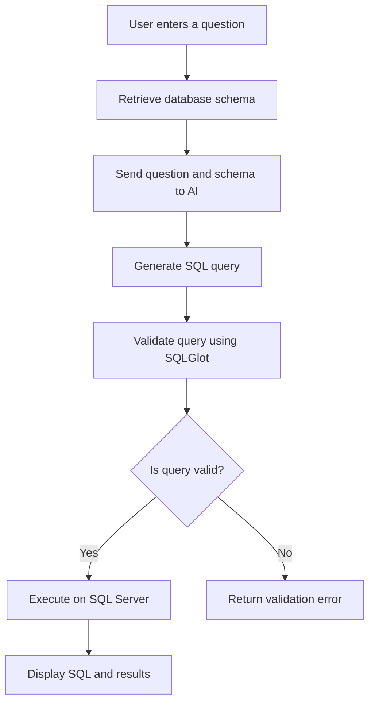

 #                                 🤖 AI-Powered Text-to-SQL Assistant

  [](https://www.python.org/)
            [](https://flask.palletsprojects.com/)
            [](https://www.microsoft.com/en-us/sql-server)
            [](https://groq.com/)
            [](https://sqlglot.com/)

**Ask questions in plain English. Get SQL queries and database results.**

An AI-powered web application that converts natural-language questions into SQL queries and executes them on a Microsoft SQL Server database.

Instead of manually writing SQL, users can ask questions such as *"Show me employees earning more than 50,000"* and retrieve the results through a simple web interface.

🔗 **GitHub Repository:** [TextToSQL-Assistant](https://github.com/aditijamkar-04/TextToSQL-Assistant)

---

## 🌟 Project Overview

Working with databases usually requires knowledge of SQL syntax, table structures, and relationships between tables.

I built this project to explore how Generative AI can simplify database interaction.

The application uses an AI model to understand a user's question, retrieve relevant database schema information, generate an SQL query, validate it, and execute it against the user's database workspace.

The project combines AI integration, Python backend development, SQL Server connectivity, query validation, and user authentication in one application.

---

## ✨ Features at a Glance

| Feature | Description |
|---|---|
| 🤖 Natural Language to SQL | Convert plain-English questions into SQL queries |
| 🧠 AI Integration | Generate queries using OpenAI GPT-OSS 20B through Groq API |
| 🛡️ SQL Validation | Validate generated queries using SQLGlot |
| 🔒 Secure Execution | Restrict execution to read-only SELECT queries |
| 👤 User Authentication | Registration, login, and role-based access |
| 🗄️ Personal Workspaces | Separate database workspaces for users |
| 📊 Query Results | Display generated SQL and database results |
| 💡 SQL Explanations | Understand what a generated query does |
| 📝 Query History | Refer to previously generated queries |
| ⚙️ Data Management | Create tables and manage workspace records |
| 💬 Feedback System | Submit suggestions and bug reports |

---

## 📸 Application Screenshots

Here is a look at the main sections of the application.

| 🔐 Login Page | 


| 🏠 User Dashboard |


| 🤖 SQL Generation |


| 📊 Query Results |


---

## ⚙️ How It Works

The application follows a structured process to convert a natural-language question into a database result.



### 🧪 Example

**User Question:**

> Show employee names, department names, and salaries for employees earning more than 50,000.

**Generated SQL:**

```sql
SELECT
    e.EmployeeName,
    d.DepartmentName,
    e.Salary
FROM Employees AS e
INNER JOIN Departments AS d
    ON e.DepartmentID = d.DepartmentID
WHERE e.Salary > 50000;
```

**Result:** The application displays the matching employee records from the database.

*This is an illustrative query based on the Employees and Departments schema. Actual output depends on the user's workspace and available data.*

---

## 🛠️ Technology Stack

| Category | Technologies |
|---|---|
| **Programming Language** | Python |
| **Backend Framework** | Flask |
| **AI Model** | OpenAI GPT-OSS 20B |
| **AI API** | Groq API |
| **Database** | Microsoft SQL Server |
| **Database Connectivity** | PyODBC |
| **SQL Validation** | SQLGlot |
| **Authentication Storage** | SQLite |
| **Frontend** | HTML, CSS, JavaScript |
| **Version Control** | Git, GitHub |

---

## 🧩 Project Structure

```text
TextToSQL-Assistant/
│
├── app.py                  # Main Flask application
├── text_to_sql.py          # AI-based SQL generation and execution
├── workspace_tables.py     # Workspace and table management
│
├── templates/              # HTML templates
├── static/                 # CSS, JavaScript, and static assets
├── instance/               # Local application data
├── screenshots/            # Project screenshots
│
├── requirements.txt        # Python dependencies
├── .env.example            # Environment variable template
├── .gitignore
└── README.md
```

---

## 🔐 Security and Query Validation

A generated SQL query should not be executed without validation.

To control database access, the application includes:

- SQLGlot-based SQL parsing and validation.
- Read-only `SELECT` query restrictions.
- Query result limits and execution timeouts.
- Password hashing and session management.
- Role-based access control.
- Separate user database workspaces.
- Environment variables for sensitive configuration.

These checks help reduce the risks associated with executing AI-generated SQL.

---

## 🚀 Getting Started

Follow these steps to run the application locally.

### 1. Clone the repository

```bash
git clone https://github.com/aditijamkar-04/TextToSQL-Assistant.git

cd TextToSQL-Assistant
```

### 2. Create a virtual environment

```bash
python -m venv .venv
```

Activate it on Windows:

```powershell
.\.venv\Scripts\Activate.ps1
```

### 3. Install dependencies

```bash
pip install -r requirements.txt
```

### 4. Configure environment variables

Create a `.env` file using `.env.example` as a reference.

Configure the required values:

- `FLASK_SECRET_KEY`
- `GROQ_API_KEY`
- `GROQ_MODEL`
- SQL Server connection details
- Workspace database credentials

Make sure the required SQL Server instance, databases, and ODBC driver are available.

**⚠️ Never upload your actual `.env` file or API keys to GitHub.**

### 5. Run the application

```bash
python app.py
```

Open the local URL displayed in your terminal.

---

## 🧠 Challenges and Learning Outcomes

Developing this project gave me practical experience with both AI integration and full-stack development.

Some of the key challenges I worked on:

- Providing database schema information to an AI model for relevant SQL generation.
- Handling natural-language questions and converting them into SQL syntax.
- Validating AI-generated queries before database execution.
- Connecting Flask with Microsoft SQL Server using PyODBC.
- Implementing authentication and role-based access.
- Managing individual user workspaces.
- Debugging issues across the frontend, backend, AI integration, and database.

**My biggest takeaway:** An AI-generated SQL query is not automatically correct or safe. It needs to be validated before it interacts with the database.

---

## 🔮 Future Improvements

- Support for additional database systems.
- Improved handling of complex SQL queries and joins.
- More detailed query explanations.
- SQL query optimization suggestions.

---

## 👩‍💻 About the Project

This project was developed as a hands-on exploration of Generative AI and its practical applications in database management.

It helped me strengthen my understanding of:

- Python and Flask development.
- Generative AI and LLM integration.
- SQL Server and database connectivity.
- SQL parsing and query validation.
- Authentication and backend security.
- Full-stack application development.

**Thanks for visiting! ⭐ If you find this project interesting, feel free to explore the repository.**
